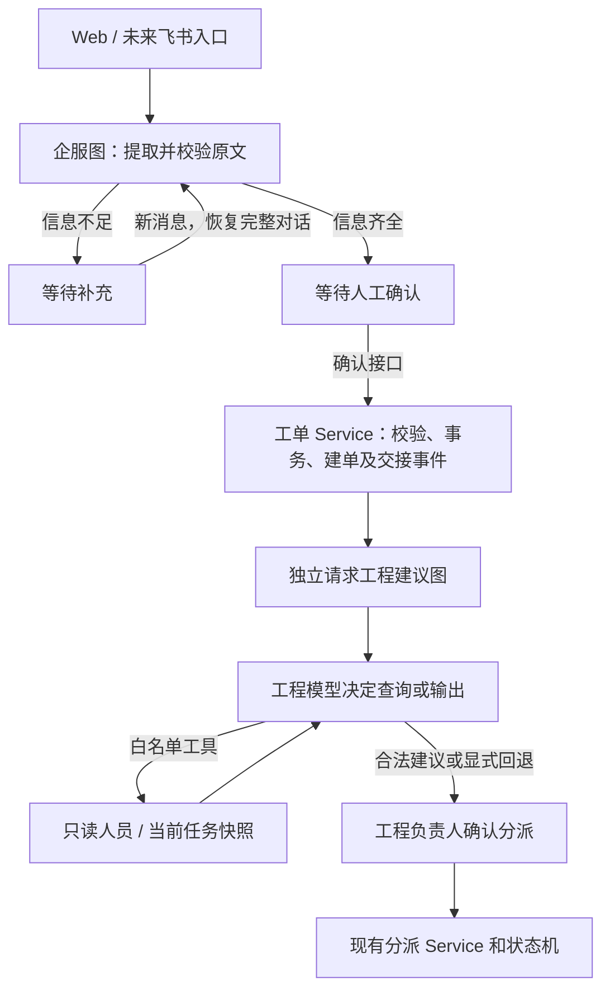

# ADR-001：选择 LangGraph 编排园区部门协作

- 日期：2026-11-01
- 状态：首期实施完成，离线验证与真实 Qwen 固定模拟资料检查通过；浏览器联调与业务质量评审待验收
- 决定：使用 LangGraph 的 StateGraph；保留 FastAPI、SQLAlchemy、现有千问传输适配和业务 Service。
- 首期范围：企服报修完整性分支 + 工程只读工具决策循环。招商目前保留结构化模型草稿和人工业务流程，尚不迁入图。

## 1. 要解决的业务问题

白皮书第七部分要求明确跨部门交接：运营期报修由企服受理、工程委派维修、企服验收；招商签约完毕后将最终版客户联系单交企服。不能为了展示三个 Agent，在每次报修时都调用招商。

例如“空调一直滴水”需要企服追问位置；补充“A栋302”后等待人工确认建单。建单后，工程助手可以查询人员技能、区域和当前工单情况，依据实际结果提出委派建议，最后由工程负责人分派。AI 初审只判断信息完整性，不能决定报修获批或拒绝。

此前实现是三类一次结构化模型请求与 Python 流程状态机，尚没有“模型选择工具 → 获取结果 → 再决定下一步”的循环。继续增加嵌套条件可以完成业务，但循环次数、失败分支和运行轨迹会分散到多个 Service。

## 2. 备选方案

| 方案 | 本项目收益 | 成本与限制 | 决定 |
| --- | --- | --- | --- |
| 继续自研 Python 状态机 | 依赖少，现有代码成熟，足以处理固定流程 | 工具循环、节点状态和轨迹需要自行约定，扩展时维护成本增加 | 保留为业务状态机与规则回退，停止扩展为通用 Agent 运行器 |
| LangGraph StateGraph | 显式共享状态、条件分支和循环，可以混合确定性规则与模型决策 | 新增依赖和图状态学习成本；不会自动解决权限、数据库事务或幻觉 | 采用，先验证一个协作切片 |
| LangChain 高层 Agent | 常规模型加工具循环上手快 | 本项目还需显式表示补项、人工交接及确定性规则，选择低层图直接控制节点 | 暂不增加高层框架；LangGraph 安装仍含其必要的底层依赖 |
| AutoGen / CrewAI 等角色协作框架 | 可按角色组织协作，是后续评估候选 | 本轮未做同条件原型和性能对比；没有证据声称它们不支持人工流程 | 不同时引入第二套编排框架，避免重复概念 |

选择依据是流程可控性与现有 Python 后端的衔接，不是“用了 LangGraph 就成为多 Agent”，也没有性能优于备选的实测结论。

## 3. 架构责任

- LangGraph 管运行状态：当前节点、模型消息、已查询证据、工具预算和轨迹。
- 业务 Service 管持久化状态：工单、分派、维修、验收、幂等与事务。模型无建单、分派、SQL、HTTP 任意访问或签约工具。
- Supervisor 首期仍按业务类型和人工阶段确定性路由，不宣称已经自主规划所有部门任务。
- 企服图仍是“结构化模型判断 + 确定性完整性分支”，不将其夸大为自主工具 Agent。工程图具有限定工具集内的决策循环；整个系统仍是逐步迁入图的部门协作系统。
- 工程只读工具基于本次请求从数据库取得的快照工作；“当前任务数”只是已记录且未结束的任务数，不等于实际工作负载、在岗或值班状态。目录是模拟名单。
- 特急 5 分钟未响应可电话对接是白皮书规则；本期不新增或虚构自动电话能力、计时调度或其他正式 SLA。

## 4. 状态、人工边界和一致性

本期不配置 LangGraph checkpointer，也不使用原生 interrupt/resume。人工等待通过现有 WorkflowSession / WorkflowEvent 及独立人工接口实现。下一条消息从持久化对话重建新一次图调用；幂等键阻止已成功请求重复执行。这个能力是应用层续办，不是图节点级崩溃恢复。

进程在模型请求中退出，可能需要重算本次尚未提交的建议。图内工具全部只读，重算不会重复创建业务对象。模型请求在写入业务数据前执行，人工建单事务内只保留快速规则建议；生成工程模型建议是单独请求。框架的持久化、流式输出与人工中断能力是后续可选项，不能算作本轮完成。

如未来引入原生 checkpoint，需另写选型记录，明确检查点和业务事务的双写、版本兼容与恢复策略；不能简单加一张 checkpoint 表就宣称 exactly-once。

## 5. 有限自主与失败处理

工程模型通过千问兼容协议请求只读工具，代码校验工具名、严格参数和可推荐编号。最终结果必须有本次查询证据；未查询人员就给出人选的回答会拒绝并回退。工具结果以 tool 消息回传，允许模型据此继续查询或结束。限制模型调用次数、工具调用数、输入与输出大小；达到预算停止并显示原因，不做无界自动重试。

在线适配补充（2026-11-01）：首次真实千问调用中，企服两项通过，工程实际完成了人员目录与任务数查询，但最终输出未通过结构校验；定位调用又观察到模型在最后一轮继续请求工具而触达预算。保留这两次未通过结论。为避免耗尽查询预算后无机会形成建议，最后一次允许的模型请求改为显式结构化收尾：停止提供工具，要求 JSON 对象并保留已查询结果。仍只有最多3次请求；无目录证据或最终输出不合法仍回退。前面的查询顺序与是否提前结束由模型决定。这是原框架内的执行策略修正，不引入第二个运行器或自动放宽输出校验。

页面联调补充：真实模型曾将“未结束分派0单”推断为“具备处理条件”。仅靠提示词无法保证自由文本不作此类推断。因此展示理由改为从工具快照拼接可核对的人员技能、区域，以及本次确实查询过的该人员任务数；不直接展示模型的自由解释。人选仍由模型在有效目录中选择，空缺人选仍交负责人处理。计数与实际负载、值班、可接单能力严格区分。这种事实展示不保证技能资料本身真实，也不代表已经证明该人最适合，最终委派仍由工程负责人判断。

离线、缺配置、远端错误、非法工具、非法编号和截断输出均返回规则建议及受控原因。规则模式可以使用图的分支，但不能显示“模型自主决策成功”。轨迹只记录节点、工具名与受控摘要，不输出推理链、密钥、供应商异常正文或任意原始消息。

LangGraph 不保证 AI 完全准确。本系统通过原文依据、只读工具证据、严格结构校验和人工确认降低错误影响；人员技能是否真实、地点含义是否正确仍需要业务核对。

## 6. 实施及退出

先写报告，再安装并固定本次验证的 LangGraph 版本；集成企服分支与工程工具循环，前端显示真实执行轨迹。现有 API 和人工确认保留，不迁移、不重建、不删除现有数据库。

成本增加主要来自工程的多轮请求，采用有界循环，不默认后台连续运行。默认每个请求超时 15 秒，多轮可能累加，3 次决策不等于 15 秒总时限。若工具调用兼容性无法通过真实千问验收，可切回 `rule` 模式继续业务流程；需要卸载图运行器时，将受理入口切回结构化解析、工程入口切回规则建议即可，业务数据格式与人工接口不依赖图运行器。新增持久化、模型 SDK 或消息队列需要新的选型记录。

安装 LangGraph 也带入 langchain-core、checkpoint、SDK 等传递依赖；“未使用高层 LangChain 框架”不等于“完全没有 LangChain 包”。本次固定 `langgraph==1.2.19`，验证环境中 langchain-core 为 1.7.3、langgraph-checkpoint 为 4.3.1。未额外接入 LangSmith 托管追踪服务；安装 checkpoint 包不会自动建立检查点存储。

## 7. 验收记录

- 已核实官方资料区分工作流和动态工具 Agent，StateGraph 支持二者。
- 已验证：后端首期130项离线测试通过，增加独立验收入口后全套 **133 项离线测试通过**。首期前端 `npm run build` 包含类型检查且通过，`python -m pip check` 通过；本次在线适配未改前端或依赖。
- 使用独立内存数据库和替换的模型传输验证，包含以下重点；测试代码见 `backend/tests/test_department_ai.py`。

| 场景 | 验证证据 |
| --- | --- |
| 企服缺项、多轮补充、读取已保存轨迹、人工建单、工程交接和建议 | `test_intake_handoff_and_engineering_graph_keep_separate_human_gates`；重复确认只有一个工单，工程建议后分派记录仍为零 |
| 工程选择不同工具顺序、依据 tool 消息继续决策 | `test_engineering_model_selects_tool_order_and_reads_results`；两种顺序均通过，计量汇总3次请求 |
| 未查询目录即直接给建议 | `test_engineering_rejects_answer_without_query_evidence`；明确 `missing_tool_evidence` 回退 |
| 越权工具、多余字段、未知人员或错误参数类型 | `test_engineering_rejects_unknown_tools_and_invalid_arguments`；未执行工具且显式回退 |
| 编造推荐编号、重复调用 ID、无限查询、截断或错误协议 | 对应工程守卫测试；预算耗尽停止，不产生业务写入 |
| 查询后超时、离线模式和空目录 | 对应工程回退测试；保留已经成功查询的轨迹，离线0次模型请求 |
| 任务数统计 | `test_engineering_snapshot_excludes_finished_and_historical_assignments`；忽略已完成工单和历史分派 |

- 入口代码：`backend/app/agents/repair_intake.py`、`backend/app/agents/engineering.py`；快照与事务边界见 `engineering_agent_service.py` 和 `workflow_service.py`。前端 `AgentTrace.vue` 展示节点与只读查询摘要。
- 未新增数据库结构，未执行迁移、未改动现有业务数据。已有中文注释保留，地址补充的说明随相应逻辑移到企服图。
- 真实 `qwen3.7-flash` 的企服缺项/补充与工程工具建议已通过三项固定模拟资料检查；工程实际执行目录、任务数两次查询并在第3次模型请求形成建议。证据和首次失败记录见 [真实千问验收报告](../verification/20261101-Qwen验收报告.md)。模型语义质量仍待用户评审，复杂场景、招商、费用评估与上线结论不由这三项检查替代。
- 本轮未做浏览器交互验收，前端结果以类型检查和构建为证据。工程建议仅返回请求轨迹；关闭或刷新后不会从服务器找回该建议。

## 8. 负责人参与点

本期沿用用户已确认的业务责任，不增加审批节点。建议负责人 review 两个边界：工程建议只能引用已取得的资料；工程负责人保留正式委派权。真实人员名单、值班制度和正式身份权限仍需后续业务资料，不用模拟数据补成事实。

## 9. 官方来源

查阅日期：2026-11-01。实现版本：LangGraph 1.2.19。

- [LangGraph overview](https://docs.langchain.com/oss/python/langgraph/overview)：有状态编排框架，可不使用 LangChain 高层框架。
- [Workflows and agents](https://docs.langchain.com/oss/python/langgraph/workflows-agents)：固定工作流与动态工具循环的区分，StateGraph 条件边和工具反馈示例。
- [Persistence](https://docs.langchain.com/oss/python/langgraph/persistence)：后续原生检查点方案参考，本期未接入。
- [Interrupts](https://docs.langchain.com/oss/python/langgraph/interrupts)：后续原生人工暂停方案参考，本期未接入。
