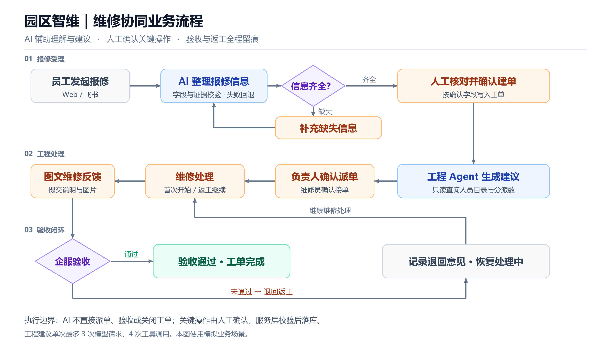
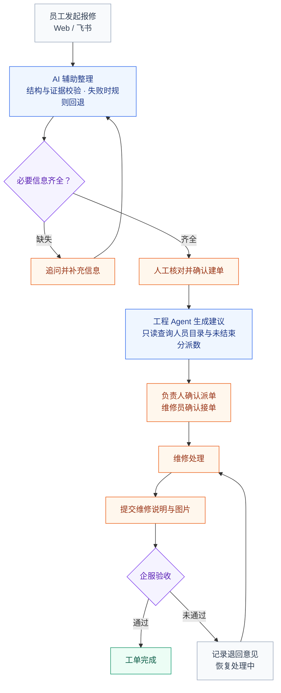

# 园区智维：维修协同业务流程

适用于作品集的主流程图，重点展示 AI 辅助、人工确认和验收返工。

## 可编辑的 Mermaid 源码

**边界：** AI 不直接分派、验收或关闭工单；工程建议单次最多3次模型请求、4次工具调用。模型不可用时使用规则回退，实际业务写入仍由服务层校验。

**展示口径：** 使用模拟资料。本机 Web / 飞书协作已有实现；当前容器部署验证以 Web 为主，公网和飞书云端桥接待进行。
