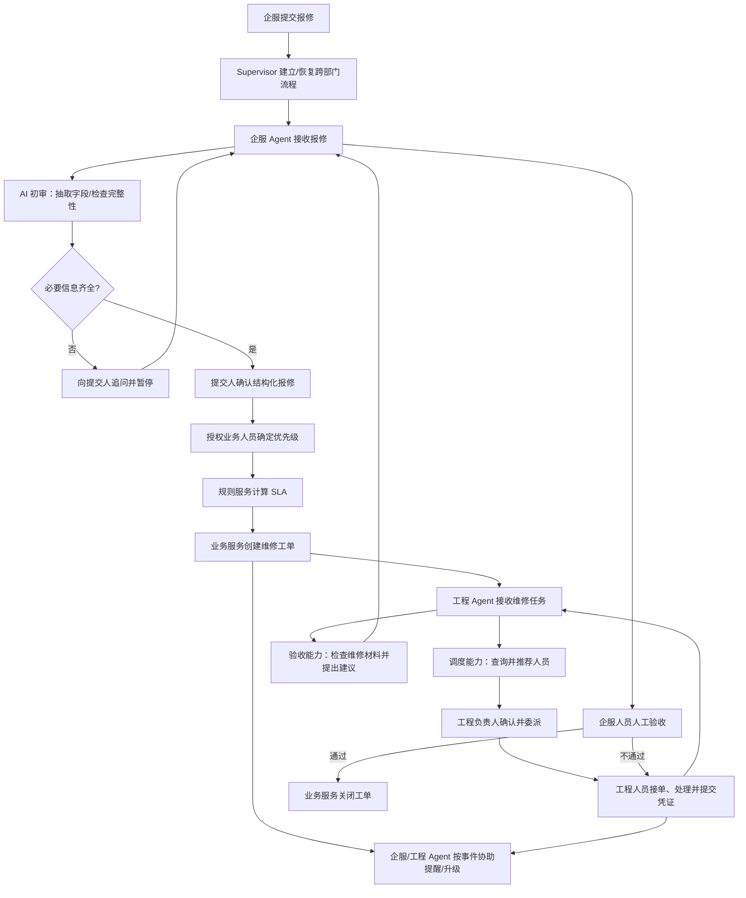
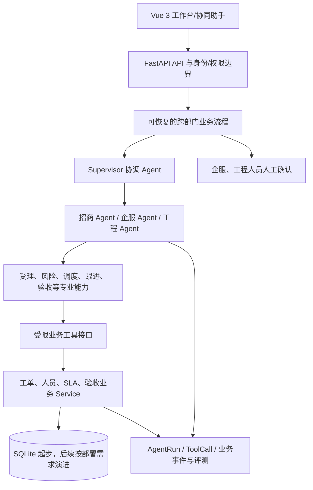

# 园区运营多 Agent 协同平台 PRD

**文档版本：** 1.0  
**项目阶段：** 维修协同 MVP 设计与迭代  
**依据：**《青岛科技创新园-流程规范白皮书》、现有项目代码与已确认的产品范围

> 实施状态补充（2026-11-01）：本文保留最初 MVP 的设计基线。后续已实现招商建档、A/B/C 回访以及签约客户联系单提交、企服接收/退回和版本留痕，最新范围、验证结果及未完成事项见[部门负责人确认矩阵](./部门负责人确认矩阵.md)。签约交接本轮只完成代码与内存数据库测试，尚未执行现有数据库迁移或完成页面联调；字段、身份和智能检查仍为明确标注的演示配置。

## 1. 文档目的

本文档是项目产品范围、业务规则、Agent 职责、技术边界和迭代计划的统一依据。它融合原 `CODEX_CONTEXT.md` 与 `园区智维Agent_PRD.md` 的项目背景、开发约束和设计内容，并对两者中相互冲突的范围作出明确取舍。

后续开发以本文档和实际代码为依据。若文档状态与代码不一致，应先检查代码和测试，更新实现状态；不得把计划能力描述为已实现能力。

## 2. 项目定位与背景

### 2.1 项目定位

本项目是一个面向园区运营流程的 AI 应用与多 Agent 协同 Demo，整体产品范围包含招商部、企服部和工程部。目标是由协调 Agent 连接三个部门 Agent，协助处理各部门高频事务，并完成跨部门交接、任务跟踪和运营汇总。

当前 MVP 先交付企服与工程之间一个边界清楚、已有业务基础、可以端到端演示的业务切片：**企服发起工程报修，工程部处理，企服确认验收并关闭工单。**招商 Agent 仍是总体架构中的一级部门 Agent，纳入后续业务切片，不因 MVP 聚焦报修而从产品范围中移除。

选择维修协同作为当前 MVP，不代表白皮书认为工程部优先级最高，也不改变产品覆盖三部门的总体目标。白皮书将招商部、企服部列为第一优先级，工程部列为第二优先级；本项目当前从维修闭环起步，主要因为已有工程工单业务基础，并且企服与工程之间的协同规则较明确。招商业务以及企服客诉/费用、工程改造等按路线图分阶段纳入。

### 2.2 白皮书原则

- 管理优先、制度先行、AI 赋能；先理顺责任、流程、时间节点和输出物，再用 AI 减少重复工作。
- 优先落地高频、耗时、规则相对明确的事项，分阶段扩展，不一次建设所有部门功能。
- 流程模板应明确职责、责任人、时间节点和关联输出物。
- 白皮书提出逐步迁移至飞书；本项目目前没有真实飞书集成，不得描述为已接入。
- 白皮书中的园区资料是业务设计参考，不代表本项目已经部署至该园区或获得真实客户数据。

### 2.3 用户与业务角色

| 角色 | 当前 MVP 职责 |
| --- | --- |
| 企服人员 | 提交报修、跟踪进度、接收异常提醒、检查维修结果并确认验收 |
| 工程负责人 | 查看待处理工单、确认维修人员、协调超时和异常任务 |
| 工程人员 | 接单、更新处理状态、提交维修说明和现场照片 |
| 园区管理人员 | 查看工单量、完成情况、逾期事项和人员工作量 |
| 系统运营者 | 维护人员技能、负责区域、流程规则和模型配置 |

招商人员属于总体平台角色，后续负责客户签约后的正式交接；财务人员属于白皮书后续费用协同的参与方，不属于当前 MVP 的操作角色。

当前人员数据是演示数据。项目没有真实工程人员名单；演示人员姓名和技能不能被描述成园区真实员工信息。

### 2.4 办公入口与运营演示（2026-11-01补充）

实际员工以飞书机器人为主要入口，接收工作、提交文字与现场图片、反馈进展；运营人员在Web维护人员/制度、追踪流程并做对外演示。两端复用同一业务后端和附件服务，不要求员工为演示效果额外使用小程序或Web重复录入。企业知识库提供规则依据，业务后端负责状态、事务、责任人、时限和审计，Agent负责理解、追问及辅助协同。

当前新增Web报修与维修反馈的图片上传、预览和留存，已在隔离演示环境验证；真实飞书图片获取、消息推送、身份权限和多模态识图仍未实现。照片目前为可选，不能将图片上传或文字初审表述为视觉理解；后续按业务制度确认凭证要求。选型见[ADR-003](./architecture/ADR-003-飞书入口与统一图片附件.md)，测试步骤见[图片上传验收](./verification/图片上传与飞书入口验收.md)。

## 3. 产品目标与边界

### 3.1 MVP 目标

1. 将自然语言报修整理成结构化草稿，并指出缺失信息。
2. 由报修提交人/授权业务人员确认故障优先级；系统按已确认的优先级应用规则并计算 SLA。AI 初审只检查信息完整性，不决定请求是否通过或优先级。
3. 查询工程人员技能、负责区域和工作负载，提供可解释的候选人员建议。
4. 由业务服务创建工单、计算 SLA 并控制状态流转。
5. 支持接单、处理、维修结果提交、凭证留存和企服验收关闭。
6. 对特急未响应和超期事项提供可追溯的提醒/升级机制。
7. 通过多个有明确职责和工具权限的 Agent 协作完成流程；执行结果可检查、可测试。

### 3.2 当前交付切片暂不实现

- 招商客户库、渠道库、客户等级和回访任务。
- 客诉作为独立业务对象的完整处理闭环。
- 客户入住联系单、费用催缴、退租、共享空间预约。
- 工程改造申请、施工节点、改造验收和交付流程。
- 固定巡检计划、自动生成巡检任务。
- 飞书、微信、银行、财务软件等外部系统的真实集成。
- 自动替人员作出最终分派、验收、关闭等关键业务决定。

上述事项属于本轮 MVP 暂不交付的业务能力，不代表项目总体不包含招商、企服或工程部门。业务数据和流程成熟后，应由对应部门 Agent 通过各自的领域 Service 和业务模型承接；不得通过临时字段或单一 `Ticket` 表提前混入维修流程。

### 3.3 业务对象区分

- **工程维修工单：** 运营期故障报修，具有接单、处理、维修反馈和企服验收流程。
- **客诉：** 客户表达的不满、服务问题或跟进请求；可能关联维修工单，但不是维修工单本身。
- **工程改造任务：** 招商/企服提出的改造需求，涉及方案、施工协调、节点和交付；与故障维修有不同生命周期。
- **Agent 执行记录：** AI 运行的技术审计记录，不替代工单、客诉或改造等业务记录。

## 4. 核心业务规则

### 4.1 报修协同规则

白皮书明确的规则：

- 报修工单按普通、加急、特急三级区分。
- 特急工单推送后 5 分钟未响应，可电话对接。
- 系统应按服务端推送/响应记录识别 5 分钟未响应并生成电话对接待办；授权人员电话联系后记录联系时间、处理人和结果。电话是否接通不由 AI 推断。
- 工单响应和完成情况纳入工程部管理考核。
- 超期工单需要自动标记并提醒，减少人工反复催办。
- 所有工单应反馈维修凭证，包括现场照片和简短说明。
- 维修完成后由企服确认关闭，不由工程人员直接关闭。
- 工程维修专属对接人尚未确认时，临时负责人安排需要由业务方确认。
- 维修结果验收不通过时，工单退回处理中，由工程继续处理后再次提交验收。

### 4.2 当前 Demo 规则与白皮书规则的区别

现有代码中的 SLA 示例为普通 24 小时接单/48 小时处理、加急 4 小时接单/8 小时处理、特急 5 分钟接单/30 分钟处理。这些是当前 Demo 的模拟配置；白皮书只明确了特急 5 分钟未响应需电话对接，并未给出上述全部 SLA 数值。后续应将 SLA 配置化，避免把模拟规则误写为园区制度。

AI 初审只检查报修信息是否完整，并指出缺失字段；不判断报修“能不能通过”，不批准或拒绝业务请求。提交人确认结构化内容后，业务服务才创建工单。优先级由业务人员按确认后的制度确定；服务端负责依据已确定的优先级计算/展示对应时限。特急升级和到期判断必须基于服务端时间及工单状态，不依赖模型自行计时。

### 4.3 跨部门协同规则（白皮书第七部分）

白皮书第七部分是本项目总体架构的业务主干。三部门 Agent 需要围绕明确的交接责任协作，而不是仅在一个页面中展示多个 Agent 名称。

| 白皮书规则 | 业务交接 | 产品落实范围 |
| --- | --- | --- |
| 7.1 报修协同 | 企服提交并跟踪报修 → 工程负责分派和维修 → 企服验收关闭 | 当前 MVP 主流程。AI 只检查报修信息完整性；工程部负责委派维修人员；企服负责最终验收 |
| 7.2 客户交接 | 招商签约完成 → 提交最终版客户工作联系单 → 后续需求和调整权责移交企服 | 后续招商/企服切片。联系单错误需保留提交部门责任；禁止用截图或纸面手写变更替代正式模板 |
| 7.3 费用管理 | 招商/企服提供合同收费及客户信息 → 财务侧统一收费台账、催缴与佣金复核 | 后续跨部门切片；本项目不声称已建财务 Agent、银行或财务软件集成 |
| 7.4 会议与文档 | 各部门会议纪要、决议待办和制度文件形成统一归档与任务流 | 平台后续协同能力；依赖飞书/文档平台集成，目前未接入 |

其中，平台当前明确的三个一级部门 Agent 是招商、企服、工程。白皮书第七部分涉及财务的流程作为未来跨部门接口和协作场景，不据此虚构第四个已实现的财务 Agent。

#### 跨部门协同事件表

下表将白皮书第七部分整理成平台级事件合同。它描述部门之间交接什么业务事实；Agent 可以协助识别、整理和跟进，但业务责任仍归属发起/接收部门及授权人员。

| 事件 | 发起方 → 接收方 | 责任人 | 触发时机 | 必要交接信息 | 接收结果/记录 | Agent 与人工边界 |
| --- | --- | --- | --- | --- | --- | --- |
| 维修报修提交 | 企服 → 工程 | 企服提交人；工程负责人接收 | 发现运营期故障并完成信息确认后 | 位置、故障现象、影响范围、联系人、提交时间、优先级；缺项需标明 | 工程维修工单、接收时间、响应状态和 SLA | 企服 Agent 只做完整性初审和缺项追问；提交人确认内容，业务服务建单；工程负责人接单并委派维修人员 |
| 特急未响应升级 | 企服/系统 → 工程负责人 | 工程负责人或当班授权人 | 特急工单推送满 5 分钟仍无响应 | 工单编号、位置、故障与风险描述、推送和响应时间 | 电话对接待办、联系时间、处理人、接通情况及后续安排 | 服务端按时间和响应状态触发待办；授权人员直接电话对接并记录结果，AI 不代打电话、不推断已联系 |
| 工程人员委派 | 工程负责人 → 指定工程人员 | 工程负责人 | 工程负责人接收报修并决定指派后 | 工单内容、优先级、处理时限、工程人员和委派时间 | 指派记录及工程人员响应状态 | 工程 Agent 可查询人员技能/区域/负载并给出建议；委派由工程负责人确认并通过业务服务记录 |
| 维修进度/超期跟进 | 工程 → 企服；系统向相关责任人提醒 | 当前工程责任人；企服跟进人 | 工单状态变化、需反馈进度或服务端识别超期时 | 工单编号、当前状态、进展、阻塞原因、责任人、时限 | 进度事件、超期标记、提醒记录和后续处理安排 | 服务端计算时限和超期；Agent 可整理摘要/提醒草稿；对外发送或电话联系由授权人员执行并留痕 |
| 维修完成反馈 | 工程 → 企服 | 实际维修人员；工程负责人复核责任按制度确认 | 维修工作完成并准备提交验收时 | 工单编号、维修说明、处理时间、现场照片及其他要求凭证 | 维修记录、附件引用、提交时间、待验收状态 | 工程人员提交真实处理结果和照片；Agent 可检查材料是否齐全，不得编造维修事实或替代提交人 |
| 验收通过/退回 | 企服 → 工程（退回时） | 企服验收人 | 工程提交维修结果后 | 原报修、维修说明、照片、验收意见 | 通过则工单关闭；不通过则退回 `processing` 并记录原因 | 验收 Agent 可核对材料完整性并提示与原问题不匹配之处；企服人员作最终决定，业务服务执行状态流转 |
| 客户签约交接 | 招商 → 企服 | 招商提交人；企服接收人 | 客户签约完成后 | 最终版客户工作联系单、合同相关服务信息、客户需求和约定事项 | 企服确认接收、后续需求责任归属和交接记录 | 招商 Agent 可检查联系单字段并生成交接摘要；招商人员确认最终版，企服人员确认接收；信息错误责任保留在提交部门 |
| 签约后需求/家具变更 | 企服 → 相关业务/工程执行方 | 企服负责人 | 签约后客户提出需求或家具二次变更时 | 客户与合同关联、正式模板变更、需求内容、费用影响 | 同意/不同意/需额外付费的决定及执行记录 | 白皮书将签约后家具二次变更权责划给企服；Agent 可整理申请和规则依据，批准/收费决定按授权流程办理，不以聊天截图或手写修改替代正式模板 |
| 合同收费信息同步 | 招商/企服 → 财务 | 合同提交部门；财务复核人员 | 合同签订或费用条款更新后 | 客户、合同版本、物业费/空调费等收费项和完整费用清单 | 统一客户收费台账、应收项目和复核状态 | Agent 可抽取并校验字段完整性；金额与合同条款由责任人员确认，当前没有财务系统集成 |
| 租金催缴与升级 | 企服/招商 → 财务及客户跟进责任人 | 企服/财务按制度分工 | 到达合同缴费/逾期节点时 | 合同、应收金额、应付日期、实收状态、催缴记录 | 缴费通知、确认记录、催缴动作和升级状态 | 白皮书存在两套节点口径：第 7 页问卷提到到期前 30 日通知、到期前 3 日确认、逾期后催缴及逾期 7 日停能；第 18 页 7.3 提到逾期 7 日、15 日、保证金消耗三个节点。节点、权限及停能条件须业务确认后才能配置，Agent 不得自行选择或执行停能 |
| 会议决议转待办 | 各部门 → 指定责任部门/人员 | 会议召集人和决议责任人 | 部门例会或高层会议形成决议后 | 会议纪要、决议事项、责任人、截止时间和关联文档 | 有负责人和到期时间的待办及完成状态 | 白皮书规划使用飞书妙记、云文档和飞书任务；Agent 可提取决议并起草待办，责任人确认后创建；当前未接入飞书 |
| 制度/合同文档归档 | 各部门 → 统一文档空间 | 文件所属部门管理员 | 制度、合同或正式文件形成/更新后 | 文件、版本、所属部门、密级/权限和生效信息 | 可检索的正式版本和变更记录 | Agent 可辅助分类、摘要和版本提醒；文档权限和正式发布由授权人员管理；当前未接入飞书云空间 |

**MVP 落地顺序：** 先实现本表前六项，即维修提交、特急电话升级、工程委派、进度/超期跟进、维修完成反馈和企服验收/退回。客户交接、费用、会议与文档事件是三个部门 Agent 的平台级扩展，不作为当前维修 MVP 的隐含功能。

### 4.4 工单状态机

```text
pending → accepted → processing → pending_review → completed
```

- `pending`：待接单。
- `accepted`：已接单。
- `processing`：处理中。
- `pending_review`：维修结果已提交，待企服验收。
- `completed`：企服验收通过并关闭。

不允许跳过必要状态或任意改写状态。验收不通过时退回 `processing`。每次状态变化记录操作人、时间、原因和前后状态。

## 5. 多 Agent 产品设计

### 5.1 设计原则

多 Agent 不是把一串固定函数改名为多个 Agent。每个 Agent 必须有独立目标、明确输入输出、有限工具权限和可验证的交接条件。Agent 只在需要语言理解、分析或决策建议时被调用；简单确定性操作由业务服务完成。

协作可以由 Supervisor 控制，但不要求每个工单都依次调用所有 Agent。流程根据当前工单状态、缺失字段、风险和人工操作结果进行条件分支、暂停和恢复。

### 5.2 部门 Agent 与专业能力

平台一级 Agent 对应组织中的业务责任边界；每个部门 Agent 内部可以调用专业能力或流程节点。不要把每个字段提取、规则查询都强行独立成一个 Agent。

| Agent | 负责的业务域 | 目标能力/允许的工具 | 禁止事项 |
| --- | --- | --- | --- |
| Supervisor 协调 Agent | 理解入口请求，识别涉及的部门，管理跨部门上下文、交接、追问、人工等待和结果汇总 | 调用招商/企服/工程部门 Agent；读取流程状态 | 直接写数据库；绕过业务服务或人工门禁 |
| 招商 Agent | 招商业务：客户/渠道信息、意向跟进、回访和成交交接 | 查询/维护客户与渠道领域数据；生成跟进建议和任务草稿；后续关联企服客户交接 | 编造客户事实、承诺成交或越权修改合同/归属；当前没有真实客户数据时不得假称已落地 |
| 企服 Agent | 企服业务：报修受理与跟进、客诉、入住交接、费用提醒和公共服务 | 对报修做 AI 信息完整性初审并追问缺项；管理客诉/交接/提醒领域工具；在维修闭环中发起工程协作并负责最终验收 | 不判断报修能否通过；不把客诉、维修工单混为同一对象；不绕过人工验收；不擅自发送外部通知 |
| 工程 Agent | 工程业务：运营期维修、工程改造、巡检整改和临时任务 | 接收企服维修交接；查询技能/区域/负载；由工程负责人确认并委派维修人员；回传处理结果与凭证 | AI 或工程人员未经负责人确认直接分派；未经企服验收直接关闭；把改造任务当维修工单；假设演示人员是真实员工 |
| 管理分析能力（后续） | 跨部门管理指标解释与摘要 | 调用招商、企服、工程的只读统计工具 | 编造统计数字或修改业务数据 |

信息完整性检查、人员信息查询、超期跟进、维修材料核对是企服/工程 Agent 可调用的专业能力。优先级由授权业务人员依据制度确定，SLA 和超时由确定性服务处理。只有当某项能力确实需要独立的目标、上下文、工具权限和交接决策时，才拆成子 Agent；否则保持为领域服务、结构化提示或规则工具。

### 5.3 Agent 交接协议

Agent 之间不通过自由文本“聊天”传递业务事实，而是通过可校验的事件对象交接。这样做的目的，是让 Supervisor 能够暂停/恢复流程，让业务 Service 能够检查输入，让人工能够知道自己确认的具体内容。

#### 5.3.1 通用交接信封

每个交接事件至少包含以下字段：

```json
{
  "event_id": "evt_xxx",
  "workflow_id": "wf_xxx",
  "event_type": "repair.intake.draft_ready",
  "business_type": "repair_ticket",
  "business_id": null,
  "sender": "qifu_agent",
  "receiver": "supervisor",
  "payload": {},
  "required_action": "human_confirm",
  "human_gate": "submitter_confirm",
  "idempotency_key": "wf_xxx:repair.intake.draft_ready:v1",
  "status": "waiting"
}
```

- `event_id`、`workflow_id` 用于追踪一次交接及其所属流程。
- `event_type` 是稳定的业务事件名，不使用模糊的“下一步”“处理一下”等文本。
- `business_id` 在业务对象创建前可以为空；创建后必须关联真实工单/客户/任务 ID。
- `payload` 只放结构化业务字段和引用，不把完整模型对话当作业务数据。
- `required_action` 明确接收方要做什么，例如 `human_confirm`、`service_write`、`wait_input`、`draft_notification`。
- `human_gate` 明确谁确认；没有人工门禁的事件必须说明其确定性依据。
- `idempotency_key` 防止重试造成重复建单、重复分派或重复提醒。
- `status` 至少区分 `waiting`、`accepted`、`completed`、`rejected`、`failed` 和 `cancelled`。

#### 5.3.2 维修 MVP 交接清单

| 事件类型 | 发送方 → 接收方 | `payload` 必填内容 | 接收方动作 | 业务写入 Service | 人工门禁/失败恢复 |
| --- | --- | --- | --- | --- | --- |
| `repair.intake.draft_ready` | 企服 Agent → Supervisor | 位置、故障现象、影响范围、联系人、原始描述、缺失字段、来源和解析模式 | 检查是否缺字段；缺失则向提交人追问，完整则等待确认 | 不写工单 | 提交人确认结构化内容；解析失败回到企服 Agent，不创建工单 |
| `repair.intake.confirmed` | 提交人/企服人员 → Supervisor | 已确认字段、确认人、确认时间、优先级（如已确定） | 形成建单请求并校验权限 | `ticket_service.create_ticket` | 提交人或授权企服确认；重复事件使用幂等键返回原工单 |
| `repair.assignment.requested` | Supervisor/企服 Agent → 工程 Agent | `ticket_id`、位置、故障、优先级、SLA、当前状态、历史事件 | 查询工程人员技能、区域、负载，返回候选和理由 | 只读人员/负载查询 | 无候选时生成待人工处理，不擅自选择；查询失败可重试 |
| `repair.assignment.confirmed` | 工程负责人 → 工程 Service | `ticket_id`、确认人员、委派人员、确认时间、理由 | 校验负责人权限和工单状态，记录正式分派 | `ticket_assignment_service.assign_ticket` | 工程负责人确认；状态或权限不符时拒绝并回 Supervisor |
| `repair.escalation.required` | SLA Service → Supervisor/工程 Agent | `ticket_id`、优先级、推送时间、当前响应时间、已逾时秒数、升级规则版本 | 生成电话对接待办并通知相关责任人 | `notification_service` 或待办 Service（后续） | 授权人员记录电话结果；未完成则保持待办，不由 AI 假设已联系 |
| `repair.completed.submitted` | 工程人员/工程 Agent → 企服 Agent | `ticket_id`、处理说明、实际处理时间、照片引用、提交人、材料检查结果 | 检查是否回应原问题和凭证是否齐全，形成验收建议 | `repair_service.create_repair_record` | 工程人员提交真实材料；材料不足回到工程处理，不进入完成状态 |
| `repair.acceptance.decided` | 企服人员/企服 Agent → Ticket Service | `ticket_id`、验收结论、验收意见、验收人、时间、关联维修记录 | 通过或退回，并记录完整原因 | `acceptance_service.create_acceptance_record` + 状态机 | 企服人员最终确认；退回 `processing`，通过才进入 `completed` |

#### 5.3.3 交接状态与事务边界

Supervisor 可以保存流程处于 `waiting_input`、`waiting_human`、`ready_for_service`、`completed` 或 `failed`，但不能用流程状态代替 `Ticket` 的业务状态。一次交接的推荐处理顺序是：

1. 校验事件结构、来源、权限和幂等键。
2. 由 Agent 或规则工具完成只读分析，形成结构化结果。
3. 在需要确认的节点暂停，并把待确认字段展示给对应人员。
4. 人工确认后，调用唯一的业务 Service 执行写入和状态变更。
5. 业务 Service 成功提交后，再将交接事件标记为 `completed` 并记录业务 ID。
6. 失败时记录原因和可重试性；可重试错误不能重复写入，不可重试错误转人工处理。

Agent 重试、页面刷新和服务重启都不能导致重复创建工单、重复委派或重复生成电话待办。事件记录、业务写入和人工确认之间的事务关系需要在实施阶段通过测试验证。

### 5.4 MVP 运行流程



图中的 Agent 只负责对应的理解或建议任务。确认、状态变化、期限判断和持久化均由授权用户或确定性业务服务完成。

### 5.5 真正的协作与可观测性

Agent 之间通过结构化结果交接，例如受理结果、缺失字段、工程人员候选和验收缺项。Supervisor 根据这些结果决定下一步，而不是简单地固定执行一串调用。

每次执行至少记录：业务对象 ID、流程/会话 ID、Agent 角色、输入摘要、结构化输出、工具名称及参数摘要、成功/失败、耗时、暂停/重试原因和人工决策结果。部门间业务事件应另有交接记录并引用对应 Agent 执行记录，避免把 Agent 内部步骤误当作已完成的部门交接。日志不应泄露 API Key、无关个人数据或完整附件内容。

可观测记录用于审计和评测，不是 Agent 能力本身。只有规则回退时，界面和文档必须明确显示 `rule_fallback_demo`，不得称为大模型推理。

### 5.6 模型策略

- 当前仓库未配置可用的 LLM API；现有自然语言解析和协调逻辑是关键词规则回退。
- 接入真实模型前先确认提供商、密钥管理、超时、重试、结构化输出和费用边界。
- 密钥只从环境变量或受控密钥服务读取，绝不硬编码进代码或提交到仓库。
- LLM 输出必须经过 Pydantic/业务规则校验；模型不能持有任意 SQL 或数据库写入能力。
- 不为追求“Agent”名词预先引入大型框架。先以明确的 Agent 接口和流程状态实现；只有确实需要持久化中断恢复、复杂分支或可视化编排时，再评估 LangGraph 等工具。

## 6. 目标系统架构



Agent 不直接访问数据库。业务 Service 是所有业务写入和状态变化的唯一入口。关键节点通过人工确认；流程运行记录与业务实体分开保存，并通过业务对象 ID 关联。

## 7. 数据模型规划

### 7.1 MVP 现有实体

| 实体 | 用途 | 处理原则 |
| --- | --- | --- |
| `Ticket` | 运营期工程维修工单 | 保留并继续作为维修流程主对象 |
| `RepairPersonnel` | 工程人员、技能和负责区域 | 当前仅为模拟目录，实际名单待业务确认 |
| `TicketAssignment` | 工单分派历史 | 保留分派审计，推荐与确认分开 |
| `RepairRecord` | 维修说明、照片引用和提交时间 | 保留凭证和处理记录 |
| `AcceptanceRecord` | 企服验收人、意见和时间 | 只有人工验收成功后才完成工单 |
| `TicketEvent` | 状态变化和操作原因 | 作为业务时间线依据 |
| `AgentRun` / `AgentToolCall` | Agent 与工具执行追踪 | 与工单通过 ID/上下文关联，不替代业务事实 |

### 7.2 规划中的实体

- `WorkflowSession` 或等效流程状态：保存可追问、可暂停、可恢复的执行上下文，避免把会话状态塞进 Agent 日志。
- `WorkflowEvent` 或等效交接记录：保存事件类型、来源/接收方、结构化 payload、人工门禁、幂等键、状态和关联业务对象；与 `AgentRun` 区分，避免把 Agent 内部步骤误当成部门间业务交接。
- `Notification` 或提醒任务：保存应提醒对象、触发原因、到期时间、发送状态及重试信息；外部发送能力单独授权和集成。
- `Complaint` / `ComplaintRecord`：后续企服客诉闭环，与维修工单可建立可选关联。
- `Customer` / `FollowUpTask` / `FollowUpRecord`：后续招商客户和跟进管理。
- `RenovationTask`：工程改造流程成熟且范围获确认后使用，不能与 `Ticket` 混为一体。
- `InspectionTask`：确认存在固定巡检制度后再设计。

新增表/字段必须先给出关系和迁移方案。不得直接重建 SQLite 数据库或删除现有数据。

## 8. API 规划

MVP API 以既有维修业务接口为主，Agent API 应建立在业务服务之上。

| API 能力 | 目标用途 |
| --- | --- |
| `POST /api/v1/agent/intake` | 解析报修并返回字段、置信/缺失信息，不创建工单 |
| `POST /api/v1/agent/runs` | 创建/恢复一次有状态的协同流程，返回下一步或追问 |
| `POST /api/v1/agent/runs/{run_id}/messages` | 补充追问所需信息并继续流程 |
| `GET /api/v1/agent/runs/{run_id}` | 查询 Agent、工具、等待人工节点和结果 |
| `POST /api/v1/agent/runs/{run_id}/confirm-ticket` | 人工确认结构化报修后通过 Service 创建工单 |
| `POST /api/v1/tickets/{id}/assignments` | 授权人员确认/记录分派 |
| `POST /api/v1/tickets/{id}/accept` | 工程人员接单 |
| `POST /api/v1/tickets/{id}/start-processing` | 开始处理 |
| `POST /api/v1/tickets/{id}/repair-records` | 提交文字和照片凭证 |
| `POST /api/v1/tickets/{id}/acceptance` | 企服人工验收并完成关闭 |
| `GET /api/v1/tickets` 与详情/事件接口 | 查询业务状态、时间线和 SLA |

表中 Agent 路由是目标设计，不代表当前全部已实现。具体路由应遵循现有 API 风格并在实施前核对代码，避免为了符合表格而重复创建等价接口。

## 9. 前端规划

### 当前工作区导航（2026-11-01）

Web现按业务任务提供三个同级工作区：维修协同 `#/repairs`、招商客户 `#/investment`、客户交接 `#/handoffs`。招商客户包含意向整理、人工建档、客户档案列表和回访；交接页面承载完整联系单及版本记录。新建工单和报修初审仍使用操作弹窗。模块切换保留同一页面内未提交的草稿，不承诺刷新后的持久化。此次调整属于界面组织，不新增自主 Agent 能力或飞书集成。取舍见[ADR-004](./architecture/ADR-004-Web业务工作区导航.md)。

### MVP 页面

1. **维修工单工作台：** 工单列表、搜索、状态/优先级、SLA 和逾期标记。
2. **协同助手：** 自然语言提交、缺失信息追问、风险建议、候选人员、人工确认和执行状态。
3. **工单详情：** 维修说明、照片凭证、状态时间线、Agent 建议和人工决定。
4. **处理工作区：** 工程人员接单、开始处理、提交维修结果；企服人员验收或退回。
5. **管理概览：** 基于数据库真实聚合的工单量、完成量、逾期量和工作量。

Agent 执行轨迹是可展开的审计/诊断视图，不应取代业务进度成为主要界面。前端不能凭空伪造 Agent 对话、工具调用或执行成功状态。

### 后续部门页面

招商客户/渠道、企服客诉/费用/入住交接、工程改造和巡检等页面分别对应三个部门 Agent 的业务域，在对应数据和流程确认后分批设计，不以静态页面冒充已实现业务。

## 10. 当前实现状态

下列状态是文档合并时对仓库的记录；每次开发前仍须以实际代码、测试和配置为准。

### 已有工程业务基础

- FastAPI、SQLAlchemy、SQLite、Pydantic、pytest 后端。
- Vue 3、Vite 前端。
- 维修工单的创建、查询、状态流转、优先级规则、SLA 服务、人员目录、分派、维修记录和企服验收相关能力。
- 最近验证：后端测试 `67 passed`；前端生产构建成功。

### Agent 原型状态

- 已有 `AgentRun`、`AgentToolCall` 记录模型和 `/api/v1/agent/coordinate`、`/api/v1/agent/runs/{run_id}` 接口。
- 当前 `coordinate_request` 是一个同步函数内固定编排多个规则函数；Agent 名称、运行记录和工具调用是真实保存的，但没有接入 LLM，也没有实现可追问/暂停/恢复的 Supervisor 决策。
- 当前原型会在一次协调请求中直接创建维修/改造数据，尚未实现“AI 完整性初审 → 提交人确认 → 业务服务建单”的人工门禁；这属于下一阶段需要修正的流程差距。
- 已有 `RenovationTask` 和跨部门维修/改造演示，是探索性原型，不属于当前确认的维修 MVP。
- 当前前端能展示多 Agent 原型执行记录，但产品方向应逐步迁移到工单生命周期协作、人工门禁和条件分支。

### 未完成/未验证

- 未配置或接入真实大模型。
- 尚未形成有标注依据的 Agent 准确率评测结果。
- 真实工程人员目录、技能、负载和授权角色尚未取得。
- 工程处理、企服验收、特急升级等规则仍有待业务方确认具体责任人和执行方式。
- 未真实接入飞书、微信或其他园区系统。
- 超时提醒、外部通知和失败恢复需核对现有实现并补足。

## 11. 评测与验收标准

### 11.1 MVP 功能验收

- 输入完整报修后，系统生成可复核的结构化草稿；确认前不创建业务工单。
- 缺少关键字段时能够追问并保持流程上下文；不根据猜测补全事实。
- AI 初审准确列出缺失字段，不输出通过/拒绝结论；优先级由授权业务人员确定，确定性服务按配置计算时限。
- 人员推荐能给出候选和数据依据，最终分派需要授权人员确认。
- 工单只能按状态机流转；维修凭证和企服验收决定可追溯。
- 白皮书特急 5 分钟未响应规则能被服务端准确识别并进入提醒/电话升级待办；实际电话由授权人员处理，除非后续明确接入获批渠道。
- Agent 失败或模型不可用时显示明确降级状态，不虚报成功。
- Agent 和工具轨迹可以关联回具体业务工单；所有统计来自真实查询。

### 11.2 评测集

建立至少 30 条模拟报修案例，覆盖普通/加急/特急、信息缺失、位置歧义、多故障、无可派人员、超时、凭证不足和验收退回等情况。AI 评测重点是字段提取与缺失信息识别；优先级属于业务规则/授权人员确定的字段，不作为 AI 自动审批指标。由人工标注预期字段和业务动作后再统计指标；不得预先编造准确率、节省时间或商业收益。

评测维度包括字段提取、缺失信息识别、调度建议质量、工具调用正确性、状态机安全、超时识别、异常恢复和端到端任务完成率。优先级决策不评测为 AI 自主判断能力。

## 12. 技术与数据安全边界

- Agent 只能通过明确授权的工具读写业务；业务写入必须进入 Service 并受权限、校验和事务约束。
- 关闭工单、确认验收、正式分派等关键动作保留人工确认。
- 模型输出属于不可信输入，需校验类型、范围、引用来源和权限。
- 所有模型调用设置超时、有限重试、错误归类和可观察的降级行为。
- API Key 使用环境变量/密钥服务；日志脱敏，不记录凭证和不必要的客户敏感信息。
- SQLite 迁移采取可回滚的增量方案；迁移前确认数据库文件、备份策略和验证步骤。未经明确任务授权，不执行迁移、不清空或删除业务数据。
- 不直接结束身份或用途不明的本地服务进程；先确认进程归属。

## 13. 技术选型

| 技术 | 作用 | 原则 |
| --- | --- | --- |
| Python / FastAPI | API 与业务服务 | 延续现有后端 |
| SQLAlchemy / SQLite | ORM 与 MVP 数据存储 | 保留现有数据；按需要增量演进 |
| Pydantic | API 和模型输出校验 | 所有 Agent 输出结构化 |
| Vue 3 / Vite | 管理工作台 | 连接真实 API |
| LLM API | 理解、建议与 Agent 决策 | 尚未接入；先配置与评测再启用 |
| Agent 框架 | 状态化流程编排 | 只有复杂分支、恢复等需求成立时再选型 |
| Langfuse 等 | 追踪/评测 | MVP 可先用自有记录与测试，避免过早增加运维负担 |

## 14. 分阶段路线图

1. **产品与流程基线：** 确认维修 MVP 角色、状态、人工确认点、特急升级路径和模拟 SLA 配置。
2. **业务基础补齐：** 检查并完善工单字段、人员负载、附件存储、权限、事务和失败回滚；保留现有业务闭环。
3. **部门 Agent 合同：** 定义 Supervisor 与招商、企服、工程三个部门 Agent 的输入输出、工具权限和事件交接；当前维修切片先落实企服与工程 Agent，招商 Agent 的业务能力以真实资料到位为前提。
4. **状态化 Supervisor：** 实现追问、等待人工、恢复、条件分支和失败处理，不把所有任务固化为一条无条件调用链。
5. **端到端维修协同：** 打通报修到企服验收闭环，在前端展示业务进度、人工决策和 Agent 审计轨迹。
6. **评测与演示交付：** 扩充标注集、运行后端测试和前端构建，形成演示脚本、架构说明和已实现/未实现清单。
7. **招商 Agent 业务切片：** 按白皮书优先级，基于实际可获得的客户/渠道资料，逐步设计客户档案、意向跟进、回访任务和成交交接；没有真实资料时用清晰标识的模拟数据评测。
8. **企服与工程其他业务切片：** 扩展独立客诉/费用/入住交接、工程改造和巡检流程；通过 Supervisor 与部门 Agent 形成明确的跨部门交接，不合并不相干的业务模型。

## 15. 开发协作约束

- 开始任务先检查实际目录、文档、模型、Schema、Service、API、测试、数据库结构和前端；不要假设文档仍然准确。
- 每项工作先说明目标、涉及模块和风险，再小步实现；保留已有中文注释和用户未提交的改动。
- 不擅自扩大产品范围、引入大型框架或进行无关重构。
- 不把规则解析说成 LLM；不把函数调用包装成自主多 Agent；不把演示数据说成真实业务数据。
- 每个阶段运行相关测试，并清楚说明结果、失败和限制。
- 面向项目开发者用中文解释重要概念和取舍，给出可理解的业务例子。
- 代码审查、架构讨论和方案阶段明确保持只读；只有用户要求实现后才改代码。

## 16. 风险与待确认事项

| 风险/问题 | 影响 | 当前处理 |
| --- | --- | --- |
| 白皮书岗位问卷未补齐工程人员、责任人和若干响应规则 | 无法验证真实分派与升级流程 | 用明确标记的模拟目录演示；上线前由业务方确认 |
| Demo SLA 与白皮书规则混淆 | 错误承诺业务时限 | 区分白皮书明确项和模拟配置，规则可配置 |
| 没有 LLM API 配置 | 无法证明真实模型 Agent 能力 | 透明标记规则回退；接入后建立评测 |
| SQLite 多 Agent/并发写入和事务边界有限 | 运行可靠性不足 | 先统一 Service/事务；并发需求出现后再评估数据库迁移 |
| 固定规则导致位置/故障抽取错误 | 可能产生错误工单 | 缺失或低置信度时追问，创建前人工确认 |
| 过早拓展到招商、客诉、改造、费用等 | 进度分散、业务模型混乱 | 按业务域分期，模型和流程彼此独立 |
| 追踪记录被误认为 Agent 智能 | 项目汇报失真 | 分开说明真实工具执行、规则回退与 LLM 推理状态 |
| 外部消息渠道尚无授权集成 | 通知无法真实送达 | 先生成站内待办/提醒草稿，不声称外部推送 |

## 附录 A：项目真实性口径

| 状态 | 对外描述 |
| --- | --- |
| 已实现且测试通过 | 可以称为已实现，并附测试范围 |
| 已实现但未充分验证 | 标注仍需验证 |
| 只有设计 | 称为计划/方案，不称为功能 |
| 使用模拟人员或业务数据 | 明确称为模拟数据 |
| 规则回退 | 明确称为规则回退，不称为 LLM |
| 未连接外部平台 | 不得称为已经集成或上线 |

## 附录 B：核心演示脚本

使用明确的模拟报修描述，例如“A 栋 302 空调漏水，水滴到插座附近，请尽快处理”。演示企服 Agent 如何提取字段并指出缺失信息；提交人确认后，由业务人员确认优先级并创建工单；工程负责人委派人员，工程提交维修凭证，最后由企服验收或退回。特急未响应演示应展示 5 分钟电话对接待办及人工记录。若当前环境未配置 LLM，开场应说明本次运行使用规则回退；不要将模拟人员、推荐结果或处理时效表述为真实园区成效。
