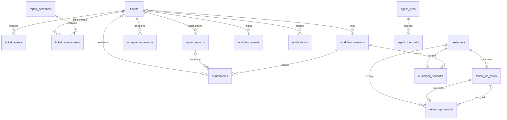

# 园区运营协同平台数据库设计

文档版本：1.0；核对日期：2026-11-09。本文以 `backend/app/models/` 的17张ORM表、业务Service、现存迁移脚本及本机数据库只读检查为依据。资料采用模拟业务数据，不包含数据库内容、真实凭据或飞书身份值。

## 1. 存储方案与范围

| 存储 | 位置或入口 | 职责与生命周期 |
| --- | --- | --- |
| 业务数据库 | 默认 `backend/park_maintenance.db` | SQLAlchemy管理工单、人员、维修、验收、招商及业务流程；路径固定，不随启动目录改变。可通过 `PARK_MAINTENANCE_DATABASE_URL` 显式覆盖 |
| 隔离演示数据库 | `backend/scripts/run_demo.py` 内的 `sqlite://` | 启动时建完整模型表，停止后清空；与默认业务库隔离，单进程共享连接通过锁串行访问 |
| 飞书渠道账本 | `backend/.local/feishu-<应用指纹前16位>.sqlite3` | 独立进程用sqlite3管理收件、回复、卡片、维修上下文和投递回执；不属于SQLAlchemy业务表 |
| 图片文件 | 默认 `backend/var/uploads/` | 业务库只存附件元数据和业务关联，文件由随机存储键定位；隔离演示使用进程生命周期内的临时目录 |

SQLite适合当前单机Demo，减少部署组件。本文没有宣称已验证多实例、高并发或生产可用性。业务库连接通过 `PRAGMA foreign_keys=ON` 开启外键检查。

## 2. 核心设计思路

1. **主表保存当前状态，记录表保存每次操作。** `tickets`表示工单当前状态；维修、验收、派工、事件分表保存，退回后不覆盖旧记录。
2. **AI输出与业务事实分开。** 草稿和建议可保存在JSON或运行轨迹中，人工确认后由Service校验和写入业务表。普通、Web、飞书协同确认建单共用 `create_ticket_from_confirmed()`，保存确认优先级。
3. **跨部门交接留痕。** 流程会话保存当前上下文，流程事件保存交接信息及幂等键；客户联系单提交时保留版本快照。
4. **文件本体与元数据分离。** 附件先校验并受控存储，再绑定流程、工单或维修记录；数据库事务回滚不等于文件自动回滚，上传服务另有失败文件回收逻辑。
5. **渠道投递与业务操作分开。** 飞书发送失败通过账本重试，不应因此重新执行派工或维修提交；这不是跨进程分布式事务。

## 3. 表关系

下图只画ORM实际声明的外键，`o`表示可选关联。部分业务关联并没有数据库外键，见下表。



| 关联 | 实际约束与含义 |
| --- | --- |
| `tickets.assignee` → `repair_personnel.personnel_no` | 字符串逻辑关联，无外键；当前责任归属还需检查 `ticket_assignments.is_current` |
| `workflow_events.workflow_id` → `workflow_sessions.workflow_id` | 无外键，Service按流程标识关联；不能画成已落库的外键 |
| `renovation_tasks.source_run_id` → `agent_runs.run_id` | 逻辑追溯，无外键；同一run_id可有多条Agent运行记录 |
| 工单 → 流程会话 | `workflow_sessions.ticket_id`没有唯一约束；当前业务通常在确认后关联一个工单，但数据库未保证一对一 |
| 维修记录 → 验收记录 | 两者分别关联工单，**没有 `repair_record_id` 或轮次外键**；可按时间展示历史，不能宣称数据库保证每条验收与某次维修一对一 |
| 客户 → 联系单 | `customer_id`唯一，当前模型每客户至多一张联系单；正式版本快照放在流程事件里，不是多张联系单 |

## 4. 字段与约束约定

- 后续数据字典的类型、可空、默认值、索引和外键来自ORM元数据。主键通常是整数，由SQLite生成；附件主键是32位随机标识字符串。没有配置数据库级严格连续的自增序列。
- “默认值”主要是SQLAlchemy客户端默认值，不等于所有直接SQL插入都有数据库默认。`updated_at`由ORM更新逻辑维护，不是数据库触发器。
- `String(n)`保留模型长度设计；SQLite本身不强制所有VARCHAR长度。接口校验与数据库非空约束也不是同一回事。
- 枚举主要使用字符串保存，并由Pydantic和Service校验，模型没有为所有状态添加数据库CHECK约束。
- `*_json`、`skills`、`photo_urls`使用TEXT保存JSON，没有原生JSON类型或数据库JSON结构校验。写入前应保证编码和数据结构正确。
- 业务时间大多使用不带时区的 `datetime.now()`；提醒规则另有北京时间处理。当前尚未统一为UTC存储，部署时需要统一约定，不能把现有时间直接当作UTC。
- 默认没有配置级联删除。清理数据需先处理附件、流程、提醒及子表，不能直接删除父表或关闭外键绕过关联。

## 5. 状态与关键业务规则

### 5.1 维修闭环

```text
pending → accepted → processing → pending_review → completed
                              ↑                │
                              └── 验收退回 ────┘
```

- `priority`为 `normal / urgent / critical`，分别表示普通、加急、特急。按人工确认值保存。
- 分派本身不改变 `pending` 状态。接单、开始维修和提交维修结果需要校验人员活跃状态及当前分派关系。
- 进入 `accepted` 时保存 `accepted_at`；维修提交时保存 `submitted_at`；退回 `processing` 时清空 `submitted_at`，保留历史维修与验收记录。
- `acceptance_records.accepted=false` 表示退回，意见保存具体返工原因；为true时通过并关闭工单。验收人可为空，页面应显示“未记录”，不能推断身份。
- 维修、验收、状态事件和对应流程事件应处于同一业务事务。Service通常只添加、flush数据，由API调用方commit；出现异常应回滚。
- SLA截止时间由优先级及创建/接单时间计算，不在工单表另存一套计时结果。自动提醒的成功投递回执放在飞书渠道账本。

### 5.2 招商与客户交接

- 客户初始阶段为 `lead`，签约联系单提交时改为 `signed`。负责人确认意向等级A/B/C，分别按1/3/7天生成回访计划。
- 回访任务初始为 `pending`，完成记录和后续任务一起提交；签约时取消尚未完成的回访任务。
- 联系单流程为 `draft → submitted → accepted`，也可 `submitted → returned → submitted`。
- `revision`用于乐观锁：更新时按请求的expected_revision及允许状态条件更新，成功后递增；与合同版本、联系单正式版本不是同一概念。
- `document_json`保存当前联系单内容，主要字段为合同编号/版本、联系单引用/版本、入驻位置、联系人/电话、服务需求和约定事项。提交版本在 `workflow_events.payload_json` 中保留快照。

### 5.3 幂等、身份与并发边界

- 流程事件、回访任务/结果及通知使用唯一幂等键；回访结果的task_id唯一，避免同任务重复形成结果。是否可重复返回旧结果仍需Service检查归属和状态。
- 普通建单接口没有统一的请求幂等键；工单号按当天数量加一生成，唯一约束可防止重复号码落库，但不能避免并发冲突和请求失败。
- `is_current`是当前派工标志，现有模型未设置“每张工单只允许一条当前派工”的部分唯一索引；单实例Service更新不能替代多实例并发约束。
- accepted_by、assigned_by、owner、actor等字符串主要用于演示身份及审计；没有用户表、部门角色表和完整登录鉴权，人员编号不是认证凭证。
- `workflow_sessions`承担应用层续办，`agent_runs`保存部分执行轨迹；没有因此启用LangGraph原生checkpointer，不能等同于原生图恢复持久化。

## 6. 当前运行库与迁移

2026-11-09只读检查的默认业务库包含9张表：`tickets`、`repair_records`、`acceptance_records`、`ticket_events`、`repair_personnel`、`ticket_assignments`、`agent_runs`、`agent_tool_calls`、`renovation_tasks`。

与17张ORM表相比，缺少以下8张：`workflow_sessions`、`workflow_events`、`customers`、`customer_handoffs`、`follow_up_tasks`、`follow_up_records`、`notifications`、`attachments`。现有9张表的字段名与相应模型已对齐；本次未逐项证明旧库全部索引、默认值与约束等同于ORM设计。

验收历史接口此前因缺少 `acceptance_records.accepted` 返回500，已备份后通过既有脚本补齐。**字段修复不代表其余缺表已经迁移。** 本文只记录结构，不执行建表、迁移或数据清理，也不把运行库表数作为永久状态。

| 当前存在的迁移脚本 | 作用与限制 |
| --- | --- |
| `backend/migrate_acceptance_fields.py` | 缺失时增加accepted列，数据库默认1；历史记录按通过兼容，不证明历史真实验收结果 |
| `backend/migrate_business_agent_tables.py` | 创建流程、客户、交接、回访、通知等新表，并补充部分旧列；不是通用的全量结构升级器 |
| `backend/migrate_attachment_table.py` | 新建附件元数据表，依赖工单、流程和维修等父表；不搬移图片 |

工作区当前另有7个旧建表/迁移脚本处于Git暂存删除状态，本文不将其列为可直接执行的现存脚本。`Base.metadata.create_all()`可创建缺失表，**不会自动补齐已有表的全部缺列、索引或约束**。主服务启动也不等于自动执行全部迁移。

升级现有库的步骤：备份数据库及图片目录 → 比对实际结构 → 按依赖安排增量变更 → 核对旧行数和关键数据摘要 → 执行 `PRAGMA foreign_key_check` → 验证工单与其他业务接口。隔离内存测试建库通过不能代替旧库升级验收。参见[验收与返工历史修复记录](verification/20261109-验收与返工历史.md)。

### 6.1 运行库迁移补充（2026-11-09）

上述9张表是文档初次核对时的状态。随后实际派工接口因缺少 `workflow_sessions` 返回500，已先备份业务库，再仅创建上述8张缺失表，运行库现有17张业务表。迁移前后既有9张表的数据摘要一致，外键检查通过，原有工单及人员保留。备份位置为 `backend/.local/before-business-tables-20261109-143247-397053.sqlite3`。

在临时数据库副本上执行派工接口返回201；通过5174代理读取工单、派工历史、验收历史、附件、客户、回访及交接接口均200。没有替用户分派实际工单或调用模型。此补充更新前述“缺少8张表”的运行状态，不代表所有前端功能和第三方集成均完成实际验收。

## 7. 备份、清理和后续改进

- 备份运行中的SQLite应使用一致性备份方式，例如sqlite3的backup接口；启用WAL时直接复制单个db文件可能漏掉事务。业务库、附件文件和飞书账本应分别备份，并明确恢复后的相互对应关系。
- 清理维修数据前先明确业务库和渠道账本是否正在使用。新模型下应检查附件、流程会话/事件、通知、派工、维修、验收、工单事件及相关Agent记录；同一流程若含改造或客户业务，不能按run_id把全部资料一并删除。
- 本机备份、渠道身份、数据库、图片和密钥不随源码公开。文档不保存真实手机号、飞书open_id或消息内容。
- 部署前仍需完成运行库与模型对齐、持久化配置、身份认证和授权。更高并发时再评估关系型数据库迁移、可靠编号生成、当前派工唯一约束、乐观锁和分页/组合索引。
- 目前验收历史按时间和id排序展示；若后续必须精确回答“第几次维修被哪次验收退回”，应评估新增明确关联字段并采用可追溯迁移，不能仅凭时间猜测。

## 8. 核查入口

- 模型：[backend/app/models](../backend/app/models/)
- 连接与外键设置：[database.py](../backend/app/database.py)
- 工单状态机：[ticket_service.py](../backend/app/services/ticket_service.py)
- 派工、维修和验收：[ticket_assignment_service.py](../backend/app/services/ticket_assignment_service.py)、[repair_service.py](../backend/app/services/repair_service.py)、[acceptance_service.py](../backend/app/services/acceptance_service.py)
- 流程、回访与交接：[workflow_service.py](../backend/app/services/workflow_service.py)、[business_agent_service.py](../backend/app/services/business_agent_service.py)、[customer_handoff_service.py](../backend/app/services/customer_handoff_service.py)
- 渠道账本：[feishu_bridge.py](../backend/app/services/feishu_bridge.py)、[feishu_engineering.py](../backend/app/services/feishu_engineering.py)、[feishu_reminders.py](../backend/app/services/feishu_reminders.py)
- 隔离演示：[run_demo.py](../backend/scripts/run_demo.py)

## 附录A：业务表数据字典

以下字段表由当前ORM元数据核对生成；字段用途为中文说明，不能替代接口校验。`—`表示未声明默认值或额外约束。

### A.1 `tickets`

维修工单：当前业务状态和时间节点。

| 字段 | 类型 | 可空 | 默认值（ORM） | 约束 | 用途 |
| --- | --- | --- | --- | --- | --- |
| `id` | INTEGER | 否 | — | PK；索引 | 内部主键 |
| `ticket_no` | VARCHAR(32) | 否 | — | UNIQUE；索引 | 对外工单编号 |
| `location` | VARCHAR(200) | 否 | — | — | 报修或入驻位置 |
| `issue_type` | VARCHAR(100) | 否 | — | — | 故障类型 |
| `description` | VARCHAR(1000) | 否 | — | — | 业务描述 |
| `priority` | VARCHAR(20) | 否 | 'normal' | — | 人工确认优先级 |
| `status` | VARCHAR(30) | 否 | 'pending' | — | 当前状态，按所在业务域解释 |
| `assignee` | VARCHAR(100) | 是 | — | — | 当前负责人编号，冗余显示字段 |
| `created_at` | DATETIME | 否 | 当前时间 | — | 创建时间 |
| `updated_at` | DATETIME | 否 | 当前时间 | — | 最近更新时间，ORM onupdate维护 |
| `accepted_at` | DATETIME | 是 | — | — | 接单或验收时间，按所在表解释 |
| `submitted_at` | DATETIME | 是 | — | — | 提交时间 |

唯一约束/唯一索引：`ticket_no`。

### A.2 `repair_personnel`

工程人员目录：模拟身份、技能与区域。

| 字段 | 类型 | 可空 | 默认值（ORM） | 约束 | 用途 |
| --- | --- | --- | --- | --- | --- |
| `id` | INTEGER | 否 | — | PK；索引 | 内部主键 |
| `personnel_no` | VARCHAR(30) | 否 | — | UNIQUE；索引 | 稳定工程人员编号 |
| `display_name` | VARCHAR(100) | 否 | — | — | 显示名称 |
| `department` | VARCHAR(50) | 否 | '工程部' | — | 部门名称 |
| `role` | VARCHAR(50) | 否 | — | — | 岗位 |
| `skills` | TEXT | 否 | — | — | 技能JSON数组文本 |
| `responsible_area` | VARCHAR(200) | 是 | — | — | 负责区域 |
| `is_active` | BOOLEAN | 否 | true | — | 是否启用 |
| `created_at` | DATETIME | 否 | 当前时间 | — | 创建时间 |

唯一约束/唯一索引：`personnel_no`。

### A.3 `ticket_assignments`

工单派工历史：当前责任归属与旧分派。

| 字段 | 类型 | 可空 | 默认值（ORM） | 约束 | 用途 |
| --- | --- | --- | --- | --- | --- |
| `id` | INTEGER | 否 | — | PK；索引 | 内部主键 |
| `ticket_id` | INTEGER | 否 | — | FK → tickets.id；索引 | 关联工单主键 |
| `personnel_id` | INTEGER | 否 | — | FK → repair_personnel.id；索引 | 工程人员主键 |
| `assigned_by` | VARCHAR(30) | 否 | — | — | 派工操作人编号 |
| `assigned_at` | DATETIME | 否 | 当前时间 | — | 派工时间 |
| `is_current` | BOOLEAN | 否 | true | — | 是否当前分派，非部分唯一约束 |

唯一约束/唯一索引：除主键外无。

### A.4 `repair_records`

维修结果：每轮提交均保留独立记录。

| 字段 | 类型 | 可空 | 默认值（ORM） | 约束 | 用途 |
| --- | --- | --- | --- | --- | --- |
| `id` | INTEGER | 否 | — | PK；索引 | 内部主键 |
| `ticket_id` | INTEGER | 否 | — | FK → tickets.id；索引 | 关联工单主键 |
| `repair_description` | TEXT | 否 | — | — | 本次维修措施及结果 |
| `photo_urls` | TEXT | 是 | — | — | 兼容照片路径JSON数组文本 |
| `submitted_at` | DATETIME | 否 | 当前时间 | — | 提交时间 |

唯一约束/唯一索引：除主键外无。

### A.5 `acceptance_records`

验收结果：意见、人员及通过或退回。

| 字段 | 类型 | 可空 | 默认值（ORM） | 约束 | 用途 |
| --- | --- | --- | --- | --- | --- |
| `id` | INTEGER | 否 | — | PK；索引 | 内部主键 |
| `ticket_id` | INTEGER | 否 | — | FK → tickets.id；索引 | 关联工单主键 |
| `acceptance_comment` | TEXT | 否 | — | — | 验收意见或退回原因 |
| `accepted_by` | VARCHAR(100) | 是 | — | — | 验收操作人，历史可为空 |
| `accepted` | BOOLEAN | 否 | true | — | 是否验收通过，false表示退回 |
| `accepted_at` | DATETIME | 否 | 当前时间 | — | 接单或验收时间，按所在表解释 |

唯一约束/唯一索引：除主键外无。

### A.6 `ticket_events`

工单状态事件：用于处理时间线。

| 字段 | 类型 | 可空 | 默认值（ORM） | 约束 | 用途 |
| --- | --- | --- | --- | --- | --- |
| `id` | INTEGER | 否 | — | PK；索引 | 内部主键 |
| `ticket_id` | INTEGER | 否 | — | FK → tickets.id；索引 | 关联工单主键 |
| `from_status` | VARCHAR(30) | 是 | — | — | 变更前状态，创建事件为空 |
| `to_status` | VARCHAR(30) | 否 | — | — | 变更后状态 |
| `actor_type` | VARCHAR(30) | 否 | 'system' | — | 操作来源类型 |
| `actor_id` | VARCHAR(100) | 是 | — | — | 操作人标识 |
| `reason` | TEXT | 是 | — | — | 原因或说明 |
| `occurred_at` | DATETIME | 否 | 当前时间 | 索引 | 事件发生时间 |
| `is_inferred` | BOOLEAN | 否 | false | — | 是否历史推断事件 |

唯一约束/唯一索引：除主键外无。

### A.7 `attachments`

现场图片元数据：文件不存入数据库。

| 字段 | 类型 | 可空 | 默认值（ORM） | 约束 | 用途 |
| --- | --- | --- | --- | --- | --- |
| `id` | VARCHAR(32) | 否 | — | PK | 内部主键 |
| `original_name` | VARCHAR(180) | 否 | — | — | 原始文件名 |
| `media_type` | VARCHAR(40) | 否 | — | — | 图片媒体类型 |
| `storage_key` | VARCHAR(40) | 否 | — | UNIQUE | 受控随机文件存储键 |
| `size_bytes` | INTEGER | 否 | — | — | 文件字节数 |
| `width` | INTEGER | 否 | — | — | 图片宽度 |
| `height` | INTEGER | 否 | — | — | 图片高度 |
| `sha256` | VARCHAR(64) | 否 | — | — | 文件摘要 |
| `purpose` | VARCHAR(20) | 否 | — | — | intake报修图或repair维修图 |
| `source_channel` | VARCHAR(30) | 否 | 'web' | — | 来源渠道 |
| `source_reference` | VARCHAR(200) | 是 | — | — | 来源消息引用，可空 |
| `workflow_id` | VARCHAR(40) | 是 | — | FK → workflow_sessions.workflow_id；索引 | 流程标识，具体是否外键见约束列 |
| `ticket_id` | INTEGER | 是 | — | FK → tickets.id；索引 | 关联工单主键 |
| `repair_record_id` | INTEGER | 是 | — | FK → repair_records.id；索引 | 绑定某次维修记录 |
| `created_at` | DATETIME | 否 | 当前时间 | — | 创建时间 |

唯一约束/唯一索引：`storage_key`。

### A.8 `workflow_sessions`

应用流程会话：草稿、缺项及业务续办。

| 字段 | 类型 | 可空 | 默认值（ORM） | 约束 | 用途 |
| --- | --- | --- | --- | --- | --- |
| `id` | INTEGER | 否 | — | PK；索引 | 内部主键 |
| `workflow_id` | VARCHAR(40) | 否 | — | UNIQUE；索引 | 流程标识，具体是否外键见约束列 |
| `channel` | VARCHAR(30) | 否 | 'web' | — | 流程入口渠道 |
| `requester_id` | VARCHAR(100) | 是 | — | — | 入口提交人标识 |
| `status` | VARCHAR(30) | 否 | 'waiting_input' | — | 当前状态，按所在业务域解释 |
| `current_step` | VARCHAR(50) | 否 | 'repair_intake' | — | 当前业务步骤 |
| `original_message` | TEXT | 否 | — | — | 原始报修或业务文本 |
| `draft_json` | TEXT | 否 | '{}' | — | 结构化草稿JSON文本 |
| `missing_fields_json` | TEXT | 否 | '[]' | — | 缺项JSON数组文本 |
| `ticket_id` | INTEGER | 是 | — | FK → tickets.id；索引 | 关联工单主键 |
| `confirmed_at` | DATETIME | 是 | — | — | 人工确认时间 |
| `created_at` | DATETIME | 否 | 当前时间 | — | 创建时间 |
| `updated_at` | DATETIME | 否 | 当前时间 | — | 最近更新时间，ORM onupdate维护 |

唯一约束/唯一索引：`workflow_id`。

### A.9 `workflow_events`

跨部门流程事件：结构化交接与幂等记录。

| 字段 | 类型 | 可空 | 默认值（ORM） | 约束 | 用途 |
| --- | --- | --- | --- | --- | --- |
| `id` | INTEGER | 否 | — | PK；索引 | 内部主键 |
| `event_id` | VARCHAR(40) | 否 | — | UNIQUE；索引 | 流程事件唯一标识 |
| `workflow_id` | VARCHAR(40) | 否 | — | 索引 | 流程标识，具体是否外键见约束列 |
| `event_type` | VARCHAR(80) | 否 | — | 索引 | 流程事件类型 |
| `source_agent` | VARCHAR(80) | 否 | — | — | 交接来源 |
| `target_agent` | VARCHAR(80) | 否 | — | — | 交接目标 |
| `business_id` | VARCHAR(100) | 是 | — | — | 业务对象标识，逻辑引用 |
| `ticket_id` | INTEGER | 是 | — | FK → tickets.id；索引 | 关联工单主键 |
| `payload_json` | TEXT | 否 | '{}' | — | 事件快照或通知载荷JSON文本 |
| `workflow_status` | VARCHAR(30) | 否 | — | — | 事件发生时流程状态 |
| `requires_human` | BOOLEAN | 否 | false | — | 是否等待人工 |
| `idempotency_key` | VARCHAR(120) | 否 | — | UNIQUE；索引 | 唯一幂等键，业务层仍需核对归属 |
| `status` | VARCHAR(20) | 否 | 'completed' | — | 当前状态，按所在业务域解释 |
| `error` | TEXT | 是 | — | — | 错误说明 |
| `occurred_at` | DATETIME | 否 | 当前时间 | 索引 | 事件发生时间 |

唯一约束/唯一索引：`event_id`；`idempotency_key`。

### A.10 `agent_runs`

Agent运行轨迹：同一run_id下可有多个Agent步骤。

| 字段 | 类型 | 可空 | 默认值（ORM） | 约束 | 用途 |
| --- | --- | --- | --- | --- | --- |
| `id` | INTEGER | 否 | — | PK；索引 | 内部主键 |
| `run_id` | VARCHAR(40) | 否 | — | 索引 | 一次协同的运行分组，非唯一 |
| `agent_name` | VARCHAR(80) | 否 | — | 索引 | Agent名称 |
| `status` | VARCHAR(20) | 否 | 'running' | — | 当前状态，按所在业务域解释 |
| `input_text` | TEXT | 否 | — | — | 输入文本 |
| `output_json` | TEXT | 是 | — | — | 结果JSON文本 |
| `error` | TEXT | 是 | — | — | 错误说明 |
| `started_at` | DATETIME | 否 | 当前时间 | — | 开始时间 |
| `completed_at` | DATETIME | 是 | — | — | 完成时间 |

唯一约束/唯一索引：除主键外无。

### A.11 `agent_tool_calls`

工具调用轨迹：输入、输出与异常。

| 字段 | 类型 | 可空 | 默认值（ORM） | 约束 | 用途 |
| --- | --- | --- | --- | --- | --- |
| `id` | INTEGER | 否 | — | PK；索引 | 内部主键 |
| `agent_run_id` | INTEGER | 否 | — | FK → agent_runs.id；索引 | 所属Agent运行记录主键 |
| `tool_name` | VARCHAR(100) | 否 | — | — | 工具名称 |
| `status` | VARCHAR(20) | 否 | 'success' | — | 当前状态，按所在业务域解释 |
| `input_json` | TEXT | 否 | — | — | 调用参数JSON文本 |
| `output_json` | TEXT | 是 | — | — | 结果JSON文本 |
| `error` | TEXT | 是 | — | — | 错误说明 |
| `started_at` | DATETIME | 否 | 当前时间 | — | 开始时间 |
| `completed_at` | DATETIME | 是 | — | — | 完成时间 |

唯一约束/唯一索引：除主键外无。

### A.12 `renovation_tasks`

独立工程改造任务：当前仅有原型范围。

| 字段 | 类型 | 可空 | 默认值（ORM） | 约束 | 用途 |
| --- | --- | --- | --- | --- | --- |
| `id` | INTEGER | 否 | — | PK；索引 | 内部主键 |
| `task_no` | VARCHAR(40) | 否 | — | UNIQUE；索引 | 任务业务编号 |
| `location` | VARCHAR(200) | 否 | — | — | 报修或入驻位置 |
| `description` | TEXT | 否 | — | — | 业务描述 |
| `status` | VARCHAR(30) | 否 | 'pending' | — | 当前状态，按所在业务域解释 |
| `source_run_id` | VARCHAR(40) | 是 | — | 索引 | 来源run_id，逻辑引用 |
| `created_at` | DATETIME | 否 | 当前时间 | — | 创建时间 |
| `updated_at` | DATETIME | 否 | 当前时间 | — | 最近更新时间，ORM onupdate维护 |

唯一约束/唯一索引：`task_no`。

### A.13 `customers`

招商客户档案。

| 字段 | 类型 | 可空 | 默认值（ORM） | 约束 | 用途 |
| --- | --- | --- | --- | --- | --- |
| `id` | INTEGER | 否 | — | PK；索引 | 内部主键 |
| `customer_no` | VARCHAR(40) | 否 | — | UNIQUE；索引 | 客户业务编号 |
| `customer_name` | VARCHAR(120) | 否 | — | — | 客户名称 |
| `contact_name` | VARCHAR(80) | 是 | — | — | 联系人 |
| `contact_phone` | VARCHAR(40) | 是 | — | — | 联系电话 |
| `stage` | VARCHAR(30) | 否 | 'lead' | — | 客户阶段 |
| `intent_level` | VARCHAR(1) | 是 | — | — | 人工确认意向等级A/B/C |
| `source` | VARCHAR(80) | 是 | — | — | 客户来源 |
| `owner` | VARCHAR(80) | 是 | — | — | 负责人演示标识 |
| `notes` | TEXT | 是 | — | — | 备注 |
| `created_at` | DATETIME | 否 | 当前时间 | — | 创建时间 |
| `updated_at` | DATETIME | 否 | 当前时间 | — | 最近更新时间，ORM onupdate维护 |

唯一约束/唯一索引：`customer_no`。

### A.14 `follow_up_tasks`

客户回访任务。

| 字段 | 类型 | 可空 | 默认值（ORM） | 约束 | 用途 |
| --- | --- | --- | --- | --- | --- |
| `id` | INTEGER | 否 | — | PK；索引 | 内部主键 |
| `task_no` | VARCHAR(40) | 否 | — | UNIQUE；索引 | 任务业务编号 |
| `customer_id` | INTEGER | 否 | — | FK → customers.id；索引 | 所属客户主键 |
| `subject` | VARCHAR(160) | 否 | — | — | 回访主题 |
| `description` | TEXT | 否 | — | — | 业务描述 |
| `owner` | VARCHAR(80) | 是 | — | — | 负责人演示标识 |
| `status` | VARCHAR(30) | 否 | 'pending' | — | 当前状态，按所在业务域解释 |
| `idempotency_key` | VARCHAR(120) | 否 | — | UNIQUE；索引 | 唯一幂等键，业务层仍需核对归属 |
| `due_at` | DATETIME | 是 | — | — | 计划到期时间 |
| `created_at` | DATETIME | 否 | 当前时间 | — | 创建时间 |
| `updated_at` | DATETIME | 否 | 当前时间 | — | 最近更新时间，ORM onupdate维护 |

唯一约束/唯一索引：`idempotency_key`；`task_no`。

### A.15 `follow_up_records`

已完成回访结果与后续任务。

| 字段 | 类型 | 可空 | 默认值（ORM） | 约束 | 用途 |
| --- | --- | --- | --- | --- | --- |
| `id` | INTEGER | 否 | — | PK；索引 | 内部主键 |
| `task_id` | INTEGER | 否 | — | FK → follow_up_tasks.id；UNIQUE；索引 | 本次完成的回访任务 |
| `customer_id` | INTEGER | 否 | — | FK → customers.id；索引 | 所属客户主键 |
| `actor` | VARCHAR(80) | 否 | — | — | 回访操作人 |
| `outcome` | TEXT | 否 | — | — | 实际回访结果 |
| `next_task_id` | INTEGER | 是 | — | FK → follow_up_tasks.id | 本次回访生成的后续任务 |
| `idempotency_key` | VARCHAR(120) | 否 | — | UNIQUE；索引 | 唯一幂等键，业务层仍需核对归属 |
| `occurred_at` | DATETIME | 否 | 当前时间 | — | 事件发生时间 |

唯一约束/唯一索引：`idempotency_key`；`task_id`。

### A.16 `customer_handoffs`

签约客户联系单：当前文档与审核状态。

| 字段 | 类型 | 可空 | 默认值（ORM） | 约束 | 用途 |
| --- | --- | --- | --- | --- | --- |
| `id` | INTEGER | 否 | — | PK | 内部主键 |
| `customer_id` | INTEGER | 否 | — | FK → customers.id；UNIQUE | 所属客户主键 |
| `workflow_id` | VARCHAR(40) | 否 | — | FK → workflow_sessions.workflow_id；UNIQUE | 流程标识，具体是否外键见约束列 |
| `status` | VARCHAR(30) | 否 | 'draft' | — | 当前状态，按所在业务域解释 |
| `revision` | INTEGER | 否 | 1 | — | 并发修改版本，区别于正式文档版本 |
| `document_json` | TEXT | 否 | '{}' | — | 当前联系单JSON文本 |
| `submitted_by` | VARCHAR(100) | 是 | — | — | 提交人 |
| `submitted_at` | DATETIME | 是 | — | — | 提交时间 |
| `decided_by` | VARCHAR(100) | 是 | — | — | 接收或退回操作人 |
| `decided_at` | DATETIME | 是 | — | — | 接收或退回时间 |
| `decision_comment` | TEXT | 是 | — | — | 交接审核意见 |
| `created_at` | DATETIME | 否 | 当前时间 | — | 创建时间 |
| `updated_at` | DATETIME | 否 | 当前时间 | — | 最近更新时间，ORM onupdate维护 |

唯一约束/唯一索引：`customer_id`；`workflow_id`。

### A.17 `notifications`

业务提醒及人工联系待办，不等同飞书投递回执。

| 字段 | 类型 | 可空 | 默认值（ORM） | 约束 | 用途 |
| --- | --- | --- | --- | --- | --- |
| `id` | INTEGER | 否 | — | PK；索引 | 内部主键 |
| `notification_no` | VARCHAR(40) | 否 | — | UNIQUE；索引 | 通知业务编号 |
| `ticket_id` | INTEGER | 是 | — | FK → tickets.id；索引 | 关联工单主键 |
| `kind` | VARCHAR(50) | 否 | — | — | 通知种类 |
| `status` | VARCHAR(30) | 否 | 'pending' | — | 当前状态，按所在业务域解释 |
| `recipient` | VARCHAR(100) | 是 | — | — | 接收人演示标识 |
| `reason` | TEXT | 否 | — | — | 原因或说明 |
| `payload_json` | TEXT | 否 | '{}' | — | 事件快照或通知载荷JSON文本 |
| `contact_result` | TEXT | 是 | — | — | 人工联系结果 |
| `contacted_by` | VARCHAR(100) | 是 | — | — | 实际联系操作人 |
| `idempotency_key` | VARCHAR(120) | 否 | — | UNIQUE；索引 | 唯一幂等键，业务层仍需核对归属 |
| `due_at` | DATETIME | 是 | — | — | 计划到期时间 |
| `created_at` | DATETIME | 否 | 当前时间 | — | 创建时间 |
| `completed_at` | DATETIME | 是 | — | — | 完成时间 |

唯一约束/唯一索引：`idempotency_key`；`notification_no`。

## 附录B：飞书渠道账本

该账本使用独立sqlite3连接和应用内锁，不加入上述业务库外键事务。以下是源码DDL的存储结构；不是当前账本中已存在全部表的声明。基础表由BridgeStore创建，工程表和提醒表分别在对应渠道初始化时创建。

### `bridge_inbox`

按message_id去重的收件与处理记录，保存重试、回复及状态。

| 字段 | SQLite类型 | 可空 | 默认值 | 主键位置 |
| --- | --- | --- | --- | --- |
| `message_id` | TEXT | DDL未声明NOT NULL | — | 1 |
| `open_id` | TEXT | 否 | — | — |
| `chat_id` | TEXT | 否 | — | — |
| `text` | TEXT | 否 | — | — |
| `kind` | TEXT | 否 | — | — |
| `status` | TEXT | 否 | 'queued' | — |
| `outgoing_text` | TEXT | DDL未声明NOT NULL | — | — |
| `attempts` | INTEGER | 否 | 0 | — |
| `retry_after` | REAL | 否 | 0 | — |
| `error_code` | TEXT | DDL未声明NOT NULL | — | — |
| `created_at` | REAL | 否 | — | — |

### `bridge_meta`

应用指纹、配对身份及连接/扫描状态；key为主键。

| 字段 | SQLite类型 | 可空 | 默认值 | 主键位置 |
| --- | --- | --- | --- | --- |
| `key` | TEXT | DDL未声明NOT NULL | — | 1 |
| `value` | TEXT | 否 | — | — |

### `bridge_sessions`

用户和会话到业务流程的映射；open_id与chat_id联合主键，workflow_id为跨库逻辑引用。

| 字段 | SQLite类型 | 可空 | 默认值 | 主键位置 |
| --- | --- | --- | --- | --- |
| `open_id` | TEXT | 否 | — | 1 |
| `chat_id` | TEXT | 否 | — | 2 |
| `workflow_id` | TEXT | 否 | — | — |

### `eng_card_views`

某用户、会话、工单与卡片种类对应的消息视图，四字段联合主键。

| 字段 | SQLite类型 | 可空 | 默认值 | 主键位置 |
| --- | --- | --- | --- | --- |
| `owner` | TEXT | 否 | — | 1 |
| `chat` | TEXT | 否 | — | 2 |
| `ticket_id` | INTEGER | 否 | — | 3 |
| `kind` | TEXT | 否 | — | 4 |
| `message_id` | TEXT | 否 | — | — |

### `eng_cards`

交互卡片令牌与状态，nonce主键；包含所有者、快照及过期时间，用于旧按钮失效。

| 字段 | SQLite类型 | 可空 | 默认值 | 主键位置 |
| --- | --- | --- | --- | --- |
| `nonce` | TEXT | DDL未声明NOT NULL | — | 1 |
| `owner` | TEXT | 否 | — | — |
| `chat` | TEXT | 否 | — | — |
| `ticket_id` | INTEGER | 否 | — | — |
| `action` | TEXT | 否 | — | — |
| `payload` | TEXT | 否 | — | — |
| `snapshot` | TEXT | 否 | — | — |
| `expires` | REAL | 否 | — | — |
| `message_id` | TEXT | DDL未声明NOT NULL | — | — |
| `status` | TEXT | 否 | 'ready' | — |

### `eng_context`

当前维修上下文，owner与chat联合主键，防止照片默认归到错误工单。

| 字段 | SQLite类型 | 可空 | 默认值 | 主键位置 |
| --- | --- | --- | --- | --- |
| `owner` | TEXT | 否 | — | 1 |
| `chat` | TEXT | 否 | — | 2 |
| `ticket_id` | INTEGER | 否 | — | — |
| `snapshot` | TEXT | 否 | — | — |

### `eng_evidence`

维修图片与消息、工单、快照、附件的关联，message_id主键。

| 字段 | SQLite类型 | 可空 | 默认值 | 主键位置 |
| --- | --- | --- | --- | --- |
| `message_id` | TEXT | DDL未声明NOT NULL | — | 1 |
| `owner` | TEXT | 否 | — | — |
| `chat` | TEXT | 否 | — | — |
| `ticket_id` | INTEGER | 否 | — | — |
| `snapshot` | TEXT | 否 | — | — |
| `attachment_id` | TEXT | 否 | — | — |

### `eng_feedback_drafts`

自然语言维修说明草稿，owner/chat/ticket_id联合主键。

| 字段 | SQLite类型 | 可空 | 默认值 | 主键位置 |
| --- | --- | --- | --- | --- |
| `owner` | TEXT | 否 | — | 1 |
| `chat` | TEXT | 否 | — | 2 |
| `ticket_id` | INTEGER | 否 | — | 3 |
| `snapshot` | TEXT | 否 | — | — |
| `messages` | TEXT | 否 | — | — |
| `description` | TEXT | DDL未声明NOT NULL | — | — |
| `ai` | TEXT | 否 | — | — |

### `eng_jobs`

工程动作队列，id去重，执行中断时阻止盲目重放写操作。

| 字段 | SQLite类型 | 可空 | 默认值 | 主键位置 |
| --- | --- | --- | --- | --- |
| `id` | TEXT | DDL未声明NOT NULL | — | 1 |
| `owner` | TEXT | 否 | — | — |
| `chat` | TEXT | 否 | — | — |
| `kind` | TEXT | 否 | — | — |
| `payload` | TEXT | 否 | — | — |
| `status` | TEXT | 否 | 'queued' | — |

### `eng_outbox`

工程消息出站账本，包含发送状态及重试次数，重试不等同重复业务提交。

| 字段 | SQLite类型 | 可空 | 默认值 | 主键位置 |
| --- | --- | --- | --- | --- |
| `id` | TEXT | DDL未声明NOT NULL | — | 1 |
| `owner` | TEXT | 否 | — | — |
| `chat` | TEXT | 否 | — | — |
| `msg_type` | TEXT | 否 | — | — |
| `content` | TEXT | 否 | — | — |
| `status` | TEXT | 否 | 'queued' | — |
| `attempts` | INTEGER | 否 | 0 | — |
| `retry_after` | REAL | 否 | 0 | — |

### `eng_sync_observed`

已观察工单快照及身份集合，ticket_id主键，用于Web变化同步。

| 字段 | SQLite类型 | 可空 | 默认值 | 主键位置 |
| --- | --- | --- | --- | --- |
| `ticket_id` | INTEGER | DDL未声明NOT NULL | — | 1 |
| `stamp` | TEXT | 否 | — | — |
| `identities` | TEXT | 否 | — | — |

### `reminder_deliveries`

通知投递账本，id主键；保存排队、发送、成功、失败/取消及成功回执时间。

| 字段 | SQLite类型 | 可空 | 默认值 | 主键位置 |
| --- | --- | --- | --- | --- |
| `id` | TEXT | DDL未声明NOT NULL | — | 1 |
| `kind` | TEXT | 否 | — | — |
| `entity_id` | INTEGER | 否 | — | — |
| `owner` | TEXT | 否 | — | — |
| `payload` | TEXT | 否 | — | — |
| `status` | TEXT | 否 | 'queued' | — |
| `attempts` | INTEGER | 否 | 0 | — |
| `retry_after` | REAL | 否 | 0 | — |
| `sent_at` | TEXT | DDL未声明NOT NULL | — | — |
| `message_id` | TEXT | DDL未声明NOT NULL | — | — |
| `chat_id` | TEXT | DDL未声明NOT NULL | — | — |
| `error_code` | TEXT | DDL未声明NOT NULL | — | — |

渠道表主键位置按SQLite PRAGMA原样记录，联合主键按1、2等标示；实际可接受数据仍需结合应用校验。表中的ticket_id、workflow_id、attachment_id、owner等不是跨数据库外键。

提醒发送前重新核对业务状态和接收身份；失败按退避重试，失效时取消。特急5分钟提醒依据相关负责人实际发送成功回执计时。当前机制是单实例账本与重试，不保证严格的分布式恰好一次投递。
